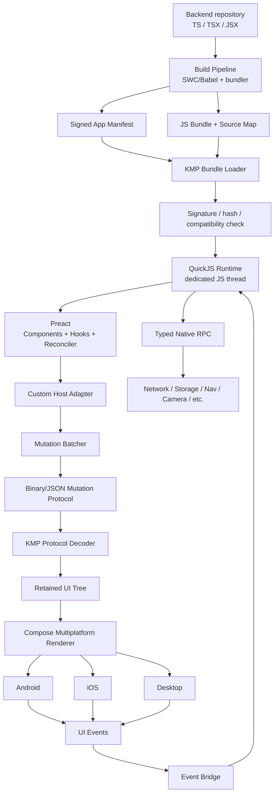
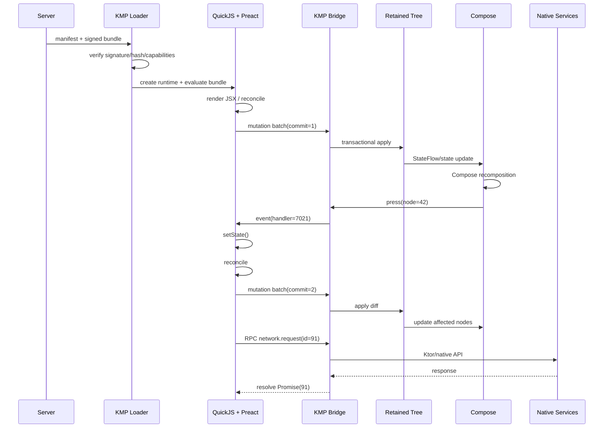

# Исследование: JSX/QuickJS → Kotlin Multiplatform → Compose Multiplatform

## Executive summary

На **22 сентября 2026 года** я не нашёл зрелого проекта, который в одном продукте реализует буквально всю требуемую цепочку:

```text
Backend JSX/TSX
      ↓
downloaded JS bundle
      ↓
QuickJS
      ↓
React/Preact + hooks + reconciliation
      ↓
retained UI tree / batched mutations
      ↓
Kotlin Multiplatform
      ↓
Compose Multiplatform
```

Но практически **каждый отдельный слой уже реализован и проверен другими проектами**. Самые важные находки:

**Lynx + ReactLynx + PrimJS** — наиболее близкий аналог твоей идеи со стороны JavaScript. Lynx запускает React-подобный UI runtime вне main thread, а актуальный ReactLynx использует **Preact как компонентную модель, hooks, render и diff engine**; host-операции Preact перехватываются и превращаются в операции над native UI. Сам Lynx использует PrimJS — движок, основанный на QuickJS. Это почти точное подтверждение жизнеспособности схемы «JSX → React-like reconciler → native mutations». citeturn6search5turn6search1turn3view1

**Cash App Redwood + Treehouse + Zipline** — наиболее близкий аналог со стороны **Kotlin Multiplatform + Compose**. Treehouse выполняет загружаемый JavaScript в Zipline/QuickJS и передаёт изменения UI через protocol adapter к platform widget system; Redwood умеет рендерить реактивный UI Android/iOS и имеет Compose integration. Главный недостаток: guest-код у него **Kotlin/JS/Compose, а не JSX/React**. Redwood прекращён как активно развиваемый проект, но архитектура исключительно полезна как референс. citeturn14view3turn7search0turn7search3turn0search9

**Keliver** — молодой форк Redwood, который продолжил именно ветку **server-driven UI → Zipline/QuickJS → Compose Multiplatform Android/iOS**. По собственному README он уже компилирует guest Compose в JS, загружает bundle, выполняет его в Zipline и протоколом переводит widget tree в реальные Compose widgets. Для твоего проекта это потенциально лучший источник готового host-side кода, но зрелость пока низкая. citeturn14view0

**Zipline** — наиболее зрелая готовая основа именно для KMP↔QuickJS: загрузка/кэширование bundles, QuickJS bytecode, RPC, `suspend`, `Flow`, serialization, подписи bundles, source maps, profiler и lifecycle. Но он оптимизирован под Kotlin/JS, поэтому для настоящего arbitrary JS/JSX может оказаться удобнее **quickjs-kt**, либо адаптированный Zipline bridge. citeturn14view4turn14view1

И наиболее важный вывод: **не стоит писать свой React с hooks и reconciler с нуля**. На сентябрь 2026 года сам ReactLynx перешёл к модели, где Preact предоставляет component model, hooks, render и diff, а Lynx перехватывает host operations. Для твоего runtime я рекомендую почти тот же приём: **Preact + собственный JSX runtime/host adapter → mutation protocol → KMP retained tree → Compose**. citeturn6search5

Есть, однако, критическое ограничение для публикации. Apple App Review Guideline 2.5.2 прямо запрещает приложению скачивать и исполнять код, который вводит или изменяет функциональность приложения; Google Play также прямо приводит в запрещённых примерах динамическую загрузку и исполнение удалённого кода, добавляющего не присутствовавшую на review функциональность. Поэтому **полный remote-JS режим технически реалистичен, но для публичного App Store/Google Play продукта его надо проектировать отдельно от store-safe SDUI режима**. citeturn23view0turn23view1

Моя итоговая рекомендация:

```text
                         JSX/TSX authoring
                               │
                        SWC/Babel/esbuild
                               │
              ┌────────────────┴─────────────────┐
              │                                  │
        Full JS Runtime                    Store-safe mode
              │                                  │
         JS bundle                         declarative IR
              │                                  │
      QuickJS + Preact                           │
              │                                  │
        Reconciliation                          │
              └──────────────┬───────────────────┘
                             │
                       Mutation Protocol
                             │
                      KMP Retained Tree
                             │
                   Compose Multiplatform
```

Так сохраняется **одинаковый JSX developer experience**, но production deployment можно выбирать в зависимости от платформы и требований магазина.

## Наиболее подходящие существующие проекты

Ниже maturity зафиксирована на **22.09.2026**. Stars округлены там, где GitHub отображает округлённое число; даты последней активности сверены с GitHub. React Native к 2026 году находится в `react/react-native`, а не в старом `facebook/react-native`; GitHub API показывает 126 689 stars. fileciteturn16file0L1-L2

| Приоритет | Проект | Языки / лицензия | Платформы | Maturity | Насколько близко | Главный gap | Интеграция |
|---|---|---|---|---|---|---|---|
| **A** | **Lynx + ReactLynx** `https://github.com/lynx-family/lynx` `https://github.com/lynx-family/lynx-stack` | C++, TS/JS, Java/Kotlin, Obj-C; Apache-2.0 | Android, iOS, Web; также desktop-направление | ≈15.1k ★; активность 22.09.2026 | **9/10** — JSX/React-like → off-main reconciliation → native UI | Не Compose/KMP; свой renderer | **High**, но главный архитектурный reference |
| **A** | **Redwood / Treehouse** `https://github.com/cashapp/redwood` | Kotlin/KMP/Kotlin-JS; Apache-2.0 | Android, iOS, Web | ≈2.0k ★; последняя активность 09.01.2026; upstream discontinued | **9/10** — QuickJS/Zipline → protocol → KMP/native widgets/Compose | Guest — Kotlin/JS Compose, не JSX | **Medium** как donor architecture |
| **A** | **Zipline** `https://github.com/cashapp/zipline` | Kotlin, Kotlin/JS, C++; Apache-2.0 | JVM/Android, Kotlin/Native/iOS | ≈2.3k ★; commit 09.09.2026 | **8.5/10** для runtime/bridge | Не UI runtime и не React; API ориентирован на Kotlin/JS | **Low–Medium** |
| **A** | **Keliver** `https://github.com/waliasanchit007/keliver` | Kotlin/KMP/Kotlin-JS; Apache-2.0 | Android + iOS/CMP | ≈1 ★; commit 15.09.2026; pre-1.0, Maven 0.3.3 | **9/10 host-side** — JS bundle → Zipline → Compose MP | Очень молодой; Kotlin Compose guest вместо JSX | **Medium** |
| **A/B** | **PrimJS** `https://github.com/lynx-family/primjs` | C++; Apache-2.0 | Android/iOS/macOS и Lynx targets | 1 144 ★; commit 19.09.2026 | **8/10 engine-side** — QuickJS-derived mobile JS VM | Нет KMP bridge или Compose | **High** вместо обычного QuickJS |
| **B** | **quickjs-kt** `https://github.com/dokar3/quickjs-kt` | Kotlin/C/C++; Apache-2.0 | Android, JVM, Kotlin/Native | 151 ★; commit 03.09.2026 | **8/10 engine binding** | Нет reconciler/UI protocol | **Low** |
| **B** | **React Native Fabric** `https://github.com/react/react-native` | C++, JS/TS, Kotlin/Java, Obj-C++; MIT | Android/iOS и community targets | 126 689 ★; commit 21.09.2026 | **8/10 conceptual** — JSX → reconciler → Shadow Tree → mutations → host views | Hermes, не QuickJS; не KMP/Compose | **High**, но лучший bridge reference |
| **B** | **Hippy** `https://github.com/Tencent/Hippy` | C++, JS/TS, Java/Kotlin, Obj-C; Apache-2.0 | Android/iOS/Web | ≈8.5k ★; commit 09.09.2026 | **7/10** — React/Vue JS bundles → JS engine → native renderer | Не QuickJS/KMP/Compose | **High** |
| **B/C** | **DivKit** `https://github.com/divkit/divkit` | Kotlin, Swift, TypeScript, Python; open source | Android/iOS/Web | ≈2.7k ★; commit 21.09.2026 | **6/10** — зрелый SDUI/protocol/schema подход | Нет JS runtime/React | **Medium**, особенно полезен для schema/versioning |
| **C** | **kuickjs** `https://github.com/peacefulprogram/kuickjs` | Kotlin/C; Apache-2.0 | KMP/JVM/native | 0 ★; commit 15.07.2026 | **7/10 engine binding** | Очень молодой проект | **Low technically / High product risk** |

### Lynx и ReactLynx — самый важный reference

Lynx буквально решает ту часть задачи, которую мы обсуждали как «свой React Native». Он позволяет писать native UI с web/React-подобной моделью, а reconciler может работать вне main thread. citeturn3view0turn6search1

Особенно важна архитектурная эволюция ReactLynx в 2026 году: его background runtime теперь строится поверх **Preact**, которому делегированы component model, hooks, rendering и diffing. При этом background runtime не имеет DOM и native views: ReactLynx **перехватывает Preact host operations** — создание элементов, изменение атрибутов, structural updates — и отправляет их в свой native layer. Это практически точная модель, которую я рекомендую нам повторить. citeturn6search5

Lynx также уже занимается compile-time оптимизацией JSX: compiler умеет выделять статическую структуру JSX в `Snapshot`, чтобы runtime обновлял только динамические части. Это полезная идея для второй стадии оптимизации нашего проекта. citeturn6search32

Его движок PrimJS основан на QuickJS, но дополнительно оптимизирован под Lynx: репозиторий заявляет другой object model, уменьшение communication overhead, tracing GC, Chrome DevTools Protocol и поддержку WebAssembly. На 22 сентября 2026 года PrimJS имеет 1 144 stars и Apache-2.0. citeturn3view1 fileciteturn12file0L1-L2

**Вывод:** для JS-половины нашей системы лучше изучать не React Native, а именно **ReactLynx + Preact + PrimJS**.

### Redwood, Treehouse, Zipline и Keliver — готовая половина KMP

Redwood проектировался как reactive multiplatform UI для Android/iOS/web. Его Treehouse-слой позволяет Kotlin/JS UI-коду выполняться в JavaScript VM и управлять host-side widget tree. citeturn14view3turn7search0

`TreehouseApp` уже решает очень неприятные operational задачи: создание и жизненный цикл Zipline runtimes, загрузку remote/embedded/cached code, hot reload и восстановление после uncaught exceptions. Это код, который имеет смысл использовать или копировать архитектурно, а не проектировать заново. citeturn7search3

Zipline, в свою очередь, уже предоставляет достаточно зрелый KMP↔QuickJS RPC. `ZiplineService` передаётся by-reference, обычные аргументы сериализуются by-value через `kotlinx.serialization`; поддерживаются `suspend` и `Flow`. Runtime привязан к одному потоку, а loader умеет загружать, кэшировать и выполнять bundles. citeturn14view4

Zipline также имеет полезные production-механизмы: предварительную компиляцию JS в QuickJS bytecode, source maps, leak detection сервисов, sampling profiler и проверку подписей Ed25519/ECDSA P-256. При этом сами авторы подчёркивают, что **Zipline не является security sandbox/process isolation** и не предназначен для выполнения недоверенного кода. citeturn14view4

Keliver идёт ещё ближе к нашей цели. Он является форком Redwood и описывает ровно цепочку:

```text
Kotlin Compose guest
        ↓ Kotlin/JS
JavaScript .zipline bundle
        ↓
Zipline / QuickJS
        ↓
Keliver protocol
        ↓
Compose widgets
        ↓
Android / iOS
```

Репозиторий также уже описывает Ed25519 signing, versioned/capability-gated bundles и host services через Zipline RPC. Но это пока маленький pre-1.0 проект, поэтому я рассматривал бы его как **донор реализации**, а не фундамент, которому безоговорочно доверяется продукт. citeturn14view0

### React Native, Hippy и DivKit — что стоит позаимствовать

React Native Fabric важен не как зависимость, а как доказанный дизайн bridge. Fabric поддерживает отдельные JS и UI threads, использует immutable renderer structures и делит pipeline на **render → commit → mount**. Native UI создаётся не во время каждого JSX-вызова; сначала строится/сравнивается shadow tree, затем commit порождает конечный набор host mutations. citeturn12search1turn12search7

Fabric также использует JSI как низкоуровневый interface между JavaScript engine и C++ core, а host view tree отделён от React Shadow Tree. Это именно та граница, которая нужна между QuickJS и KMP runtime. citeturn12search11

Новый renderer централизует значительную часть логики в C++, поддерживает type-safe codegen для props и умеет flattening layout-only nodes. Для нашего проекта аналогами будут **KMP shared protocol/types**, schema codegen и удаление виртуальных layout nodes ещё до Compose. citeturn12search3turn12search10

Hippy — ещё один production-oriented референс React/Vue→native: проект имеет JS driver, DOM/virtual tree layer и platform-specific renderers Android/iOS. Его полезно изучить для component manager, event bridge и list virtualization, но тащить непосредственно в KMP-проект нет смысла. citeturn16search6turn9view1

DivKit решает противоположную половину проблемы: вместо исполняемого JS сервер передаёт декларативное JSON-описание UI, для которого есть Android/iOS/Web renderers и server-side builders для Kotlin/TypeScript/Python. Он особенно полезен как reference для **versioned schema, expressions, actions, variables, compatibility и backend tooling**. citeturn9view2turn9view3

## Рекомендуемая целевая архитектура

Я бы строил систему как гибрид идей **ReactLynx + Fabric + Redwood/Treehouse**, а не как порт React Native.



### JSX не надо парсить на устройстве

С backend/build side разработчик пишет:

```tsx
import {
  Screen,
  Column,
  Text,
  Button,
  Icon
} from "@acme/ui"

export function CounterScreen() {
  const [count, setCount] = useState(0)

  return (
    <Screen id="counter">
      <Column padding={24} gap={12}>
        <Text variant="title">
          Count: {count}
        </Text>

        <Button
          icon="plus"
          onPress={() => setCount(v => v + 1)}
        >
          Increase
        </Button>
      </Column>
    </Screen>
  )
}
```

JSX должен компилироваться **до доставки на телефон**. Babel уже позволяет переназначить automatic JSX runtime через `importSource`; JSX:

```tsx
<Button>Save</Button>
```

можно заставить превратиться не в React DOM, а в вызов нашего:

```js
import { jsx } from "@acme/runtime/jsx-runtime"

jsx(Button, {
  children: "Save"
})
```

Именно для этого Babel официально поддерживает custom automatic-runtime import source. citeturn19view0

В production я бы предпочёл **SWC или esbuild для скорости build pipeline**, оставив Babel как наиболее удобный reference/transform layer. SWC нативно понимает TSX/JSX и позволяет задавать target/transform configuration. citeturn19view1

### Не писать свой React — использовать Preact

Runtime bundle:

```text
application JS
      │
      ├── @acme/ui
      │
      ├── preact
      │
      └── @acme/runtime
              │
              ├── hostConfig
              ├── eventRegistry
              ├── rpcClient
              └── scheduler
```

Preact должен отвечать за:

```text
function components
hooks
component state
context
effects
keys
child reconciliation
render scheduling
virtual tree diff
```

А твой runtime — только за host operations:

```ts
interface Host {
  create(type: ComponentType): NodeId

  update(
    node: NodeId,
    prev: Props,
    next: Props
  ): void

  insert(
    parent: NodeId,
    child: NodeId,
    index: number
  ): void

  remove(
    parent: NodeId,
    child: NodeId
  ): void

  setText(
    node: NodeId,
    value: string
  ): void
}
```

Именно разделение «Preact занимается React semantics, наш runtime перехватывает host operations» теперь применяет ReactLynx. citeturn6search5

### JSX → virtual node → host tree

Логическое представление:

```json
{
  "type": "Column",
  "key": null,
  "props": {
    "padding": 24,
    "gap": 12
  },
  "children": [
    {
      "type": "Text",
      "props": {
        "variant": "title",
        "text": "Count: 0"
      }
    },
    {
      "type": "Button",
      "props": {
        "icon": "plus"
      },
      "eventHandlers": {
        "press": 7021
      },
      "children": ["Increase"]
    }
  ]
}
```

Но **этот JSON не надо пересылать целиком после каждого render**.

Это принципиально.

Guest runtime хранит virtual tree, reconciler вычисляет diff:

```text
old VDOM
   │
   │ setState()
   ▼
new VDOM
   │
   ▼
reconcile
   │
   ▼
minimal mutation set
```

и только его пересылает host.

### Mutation protocol

Например:

```json
{
  "protocol": 1,
  "surfaceId": 7,
  "commitId": 184,
  "mutations": [
    {
      "op": "setProps",
      "nodeId": 42,
      "props": {
        "text": "Count: 1"
      }
    }
  ]
}
```

Первоначальный mount:

```json
{
  "protocol": 1,
  "surfaceId": 7,
  "commitId": 1,
  "mutations": [
    {
      "op": "create",
      "id": 1,
      "type": "Screen"
    },
    {
      "op": "create",
      "id": 2,
      "type": "Column"
    },
    {
      "op": "setProps",
      "id": 2,
      "props": {
        "padding": 24,
        "gap": 12
      }
    },
    {
      "op": "insert",
      "parent": 1,
      "child": 2,
      "index": 0
    },
    {
      "op": "create",
      "id": 3,
      "type": "Text"
    },
    {
      "op": "setProps",
      "id": 3,
      "props": {
        "text": "Count: 0",
        "variant": "title"
      }
    },
    {
      "op": "insert",
      "parent": 2,
      "child": 3,
      "index": 0
    }
  ]
}
```

В production я бы использовал не JSON, а компактный **CBOR/MessagePack/Protobuf-подобный бинарный wire format**, сохранив JSON только для devtools. Но semantics должны быть одинаковыми.

### KMP retained tree

На Kotlin стороне:

```kotlin
@JvmInline
value class NodeId(val value: Long)

sealed interface UiNode {
    val id: NodeId
}

data class ColumnNode(
    override val id: NodeId,
    val props: ColumnProps,
    val children: List<NodeId>,
) : UiNode

data class TextNode(
    override val id: NodeId,
    val props: TextProps,
) : UiNode

data class ButtonNode(
    override val id: NodeId,
    val props: ButtonProps,
    val children: List<NodeId>,
    val events: Map<EventType, HandlerId>,
) : UiNode
```

Host держит:

```kotlin
interface UiTree {
    fun apply(commit: MutationBatch): ApplyResult
    fun snapshot(): UiTreeSnapshot
}
```

Принцип:

```text
JS owns logical component tree
Kotlin owns host retained tree
Compose observes Kotlin tree
```

QuickJS **не должен напрямую вызывать Composable-функции**.

### Compose renderer

```kotlin
@Composable
fun RenderNode(
    id: NodeId,
    runtime: UiRuntime,
) {
    val node by runtime.observeNode(id)

    when (val value = node) {
        is ColumnNode -> RenderColumn(value, runtime)
        is TextNode -> RenderText(value)
        is ButtonNode -> RenderButton(value, runtime)
        is ImageNode -> RenderImage(value)
        is LazyListNode -> RenderLazyList(value, runtime)
        else -> runtime.reportUnsupported(value)
    }
}
```

Получается очень важная граница:

```text
          untrusted/dynamic-ish side

QuickJS → Preact → mutations

================ PROTOCOL ================

             native side

KMP Tree → Compose renderer → OS
```

JS не получает объект `Context`, `UIView`, `Activity`, `File`, `Socket` и т. д.

## Bridge, capabilities и lifecycle

### Двунаправленный message flow



### Не один generic `Native.call()`

Плохая модель:

```js
Native.call("whatever", anything)
```

Хорошая:

```ts
interface NavigationService {
  push(route: string, params: JsonValue): Promise<void>
  pop(): Promise<void>
}

interface HttpService {
  request(input: HttpRequest): Promise<HttpResponse>
}

interface StorageService {
  get(key: string): Promise<string | null>
  set(key: string, value: string): Promise<void>
}
```

А в Kotlin:

```kotlin
interface HostService

interface NavigationService : HostService {
    suspend fun push(
        route: String,
        params: JsonObject,
    )
}
```

Это позволяет:

```text
type checking
capability filtering
authorization
versioning
logging
metrics
rate limiting
testing
mocking
```

и очень близко к модели `ZiplineService`. Zipline уже показывает, что typed interfaces, by-value serialization, pass-by-reference services, suspend calls и Flow жизнеспособны на KMP/QuickJS границе. citeturn14view4

### Capability negotiation

Перед запуском bundle host сообщает:

```json
{
  "type": "host.hello",
  "protocol": {
    "major": 1,
    "minor": 8
  },
  "runtime": {
    "engine": "quickjs",
    "runtimeVersion": "0.4.0"
  },
  "platform": {
    "os": "ios",
    "osVersion": "26.0"
  },
  "components": {
    "Text": 3,
    "Column": 2,
    "Button": 4,
    "Input": 5,
    "LazyList": 3,
    "Table": 1,
    "Map": 0
  },
  "services": {
    "navigation": 2,
    "http": 3,
    "storage": 1,
    "camera": 0
  }
}
```

Bundle manifest:

```json
{
  "bundleId": "profile-screen",
  "version": "2026.09.22.4",
  "entry": "index.js",
  "sha256": "...",
  "signature": "...",

  "protocol": {
    "min": "1.5",
    "max": "1.x"
  },

  "requires": {
    "components": {
      "Text": ">=2",
      "Column": ">=2",
      "Button": ">=3"
    },
    "services": {
      "navigation": ">=1",
      "http": ">=2"
    }
  },

  "optional": {
    "components": {
      "Map": ">=1"
    }
  }
}
```

Это должно проверяться **до `evaluate()`**.

Если bundle содержит:

```tsx
<Map />
```

а host его не поддерживает, возможны три стратегии:

```tsx
<Capability
  name="Map"
  fallback={
    <Text>Карта недоступна в этой версии</Text>
  }
>
  <Map location={location} />
</Capability>
```

или bundle не запускается:

```text
BUNDLE_INCOMPATIBLE
required: Map >= 1
available: Map = 0
```

или backend вообще отдаёт старому клиенту другой bundle.

Keliver уже использует идею capability-gated bundle; React Native Fabric, в свою очередь, показывает ценность codegen/type-safe host component contracts. citeturn14view0turn12search3

### UI events

В JS:

```tsx
<Button onPress={save}>
  Save
</Button>
```

Runtime не сериализует функцию.

Он регистрирует её:

```text
handlerId 7021 → JS closure save
```

Native tree получает:

```json
{
  "nodeId": 42,
  "event": "press",
  "handlerId": 7021
}
```

На tap:

```json
{
  "type": "ui.event",
  "surfaceId": 7,
  "sequence": 9901,
  "nodeId": 42,
  "handlerId": 7021,
  "event": "press",
  "payload": {
    "x": 18.0,
    "y": 23.5
  }
}
```

QuickJS:

```text
handlerRegistry[7021](payload)
```

Дальше Preact сам произведёт render/reconciliation.

### RPC

JS:

```ts
const response =
  await native.http.request({
    method: "GET",
    url: "/api/users"
  })
```

Bridge request:

```json
{
  "type": "rpc.request",
  "requestId": 812,
  "service": "http",
  "method": "request",
  "args": {
    "method": "GET",
    "url": "/api/users"
  }
}
```

Response:

```json
{
  "type": "rpc.resolve",
  "requestId": 812,
  "result": {
    "status": 200,
    "body": {}
  }
}
```

Ошибка:

```json
{
  "type": "rpc.reject",
  "requestId": 812,
  "error": {
    "code": "NETWORK_TIMEOUT",
    "message": "Request timed out",
    "retryable": true
  }
}
```

Отмена:

```json
{
  "type": "rpc.cancel",
  "requestId": 812
}
```

Это принципиально лучше callback hell и позволяет естественно использовать JS `Promise` ↔ Kotlin `suspend`.

### Навигация

Я бы **не отдавал navigation stack полностью JavaScript**.

JS объявляет намерение:

```tsx
<Button
  onPress={() =>
    navigation.push("user.details", {
      id: user.id
    })
  }
/>
```

Native host проверяет route:

```kotlin
navigator.push(
    route = "user.details",
    params = params,
)
```

Именно KMP знает:

```text
deep links
back stack
Android back
iOS navigation semantics
permissions
native screens
authentication gates
```

Таким образом JSX-экран может переходить и в другой dynamic screen, и в native screen.

### Lifecycle

Я бы ввёл состояния:

```text
CREATED
   ↓
BUNDLE_LOADING
   ↓
RUNTIME_STARTING
   ↓
MOUNTED
   ↓
ACTIVE
 ↙     ↘
PAUSED  BACKGROUND
   \     /
    DISPOSING
       ↓
    DISPOSED
```

QuickJS получает:

```ts
runtime.on("foreground", ...)
runtime.on("background", ...)
runtime.on("memoryPressure", ...)
runtime.on("dispose", ...)
```

А surface отдельно имеет:

```text
mount
appear
disappear
unmount
```

Не надо уничтожать весь QuickJS runtime при каждом navigation transition.

### Hot update

Treehouse уже имеет модель hot reload загружаемого runtime-кода и restart после uncaught exception, что является хорошим operational reference. citeturn7search3

Для нашей системы:

```text
manifest poll / WebSocket
          ↓
new version available
          ↓
download in background
          ↓
hash + signature
          ↓
compatibility check
          ↓
create candidate QuickJS runtime
          ↓
bootstrap smoke check
          ↓
snapshot old state
          ↓
swap surface
          ↓
dispose old runtime
```

Не:

```text
download → immediately eval over live runtime
```

Так обеспечивается rollback.

## Производительность, безопасность и tooling

### Как не убить производительность bridge'ом

Главное правило:

> **JS↔Kotlin bridge должен передавать commits, а не отдельные Compose-вызовы.**

Плохо:

```text
JS create Text
   ↓ JNI/Kotlin

JS set text
   ↓ JNI/Kotlin

JS set padding
   ↓ JNI/Kotlin

JS insert child
   ↓ JNI/Kotlin
```

Лучше:

```text
           one reconciliation

create
set props
insert
update
remove
   │
   ▼
MutationBuffer
   │
   ▼
ONE bridge crossing
   │
   ▼
transactional apply
```

React 18 automatic batching в новой React Native architecture существует именно для сокращения промежуточных рендеров; Fabric затем разделяет render/commit/mount. citeturn12search12turn12search7

### Frame-critical вещи должны оставаться native

Через JS не стоит посылать 60–120 обновлений в секунду для:

```text
scroll offsets
drag coordinates
animations
fling
text layout
pointer movement
video frames
canvas
map camera
```

Вместо:

```tsx
<View
  x={animatedX}
/>
```

каждый frame JS→native, лучше:

```tsx
<Animated
  target="translateX"
  from={0}
  to={200}
  duration={300}
/>
```

и animation выполняет Compose native side.

А gestures:

```tsx
<SwipeGesture
  onComplete={handleComplete}
/>
```

где в JS идёт только semantic event:

```text
swipe completed
```

Это один из наиболее важных design constraints будущего runtime.

### Lists и tables

Для:

```tsx
{users.map(user => (
  <UserRow user={user} />
))}
```

10 000 элементов нельзя превращать в 10 000 host nodes.

Нужен host primitive:

```tsx
<LazyList
  data={users}
  keyExtractor={u => u.id}
  renderItem={UserRow}
/>
```

и специальный lazy protocol.

То же для таблиц:

```tsx
<DataTable
  rows={orders}
  columns={[
    {
      id: "customer",
      render: row => <Text>{row.customer.name}</Text>
    },
    {
      id: "total",
      render: row => <Money value={row.total} />
    }
  ]}
/>
```

Virtualization должна происходить **на host/Compose стороне**, иначе JS bridge станет bottleneck.

### QuickJS limits

QuickJS даёт необходимые механизмы для ограничения runtime: API позволяет задавать memory limit, maximum stack size и interrupt handler, который можно использовать для timeout/cancellation. citeturn17search11

Для каждого runtime я бы задал:

```text
JS heap:            32–64 MB initial policy
max stack:          bounded
sync execution:     8–16 ms soft budget
hard execution:     configurable timeout
mutation batch:     max N operations
RPC payload:        max bytes
tree nodes:         max count
network domains:    allow-list
timers:             quota
concurrent RPC:     quota
```

Цифры нужно профилировать, но механизм должен быть заложен с первого дня.

### QuickJS bytecode

QuickJS позволяет выполнять заранее скомпилированный bytecode быстрее, но его документация подчёркивает два свойства:

1. bytecode связан с конкретной версией QuickJS;
2. перед исполнением bytecode не выполняется security validation, поэтому его нельзя принимать из недоверенного источника. citeturn17search11

Поэтому manifest обязан содержать:

```json
{
  "engine": "quickjs",
  "engineAbi": "2026-x",
  "format": "bytecode",
  "sha256": "...",
  "signature": "..."
}
```

а host никогда не должен запускать неподписанный bytecode.

### JS sandbox — не security boundary

Очень важное различие:

```text
QuickJS isolation != OS sandbox
```

Даже если убрать `eval`, `fetch`, filesystem и native APIs, у тебя остаются:

```text
CPU exhaustion
memory exhaustion
bridge abuse
huge mutation trees
RPC flooding
logic bugs
malicious signed bundle
native bridge vulnerabilities
```

И Zipline прямо предупреждает, что его VM не является sandbox/process isolation для untrusted code. citeturn14view4

Поэтому production security:

```text
Signed bundle
     +
strict capability API
     +
memory limits
     +
execution timeout
     +
payload limits
     +
RPC permissions
     +
network allowlist
     +
rollback protection
     +
audit log
```

Для действительно недоверенного кода нужен отдельный OS process там, где платформа позволяет это сделать.

### Самая большая product-проблема — App Store

Здесь архитектуру нужно определить **до разработки**.

На iOS действующее правило 2.5.2 говорит, что приложение не должно скачивать, устанавливать или исполнять код, который вводит или изменяет features/functionality приложения. citeturn23view0

Google Play также прямо говорит не загружать и не исполнять динамически удалённый код, который вводит functionality, отсутствовавшую во время review. citeturn23view1

Поэтому:

```text
Remote:
<Text />
<Button />
layout JSON
server data
theme
predefined actions
```

значительно легче обосновать как SDUI/configuration.

А:

```text
fetch("app.js")
QuickJS.eval(app.js)
```

с произвольной новой application logic — существенно более рискованная модель.

Отсюда я предлагаю **два wire targets для одного JSX source**.

### Full runtime target

Для:

```text
Desktop
enterprise distribution
internal apps
development
controlled environments
platforms/policies where permitted
```

pipeline:

```text
TSX
 ↓
JS
 ↓
QuickJS
 ↓
Preact
 ↓
mutations
```

### Declarative target

Для store-safe production можно компилировать тот же JSX:

```tsx
<Column gap={12}>
  <Text>{user.name}</Text>

  <Button action={Actions.openProfile(user.id)}>
    Open
  </Button>
</Column>
```

не в executable JavaScript, а в:

```json
{
  "type": "Column",
  "props": {
    "gap": 12
  },
  "children": [
    {
      "type": "Text",
      "binding": "$user.name"
    },
    {
      "type": "Button",
      "action": {
        "type": "openProfile",
        "args": {
          "id": "$user.id"
        }
      },
      "children": ["Open"]
    }
  ]
}
```

То есть разработчик всё равно пишет JSX, но device получает **data**, а не executable application code.

Это, на мой взгляд, ключевая архитектурная развилка.

### Tooling

Минимальный toolchain:

```text
                   IDE
                    │
                  TSX
                    │
             TypeScript types
                    │
           ESLint/custom rules
                    │
                SWC/Babel
                    │
                  bundle
                    │
        ┌───────────┴───────────┐
        │                       │
      dev                     prod
        │                       │
 source maps              minification
 websocket               signing/hash
 hot reload                 manifest
        │                       │
        └───────────┬───────────┘
                    ↓
                 device
                    ↓
           QuickJS DevTools
```

Babel automatic JSX runtime особенно удобен потому, что можно официально указать собственный `importSource` и превратить JSX в функции именно нашего runtime. citeturn19view0

Source maps необходимо хранить вместе с конкретным `bundleId + version + hash`, чтобы native crash:

```text
QuickJSException
    at t (bundle.min.js:1:81721)
```

в backend observability превращался в:

```text
ProfileScreen.tsx:83:17
```

Zipline уже является хорошим reference для source-map integration и profiler around QuickJS. citeturn14view4

Dev hot reload:

```text
IDE save
  ↓
incremental SWC build
  ↓
WebSocket
  ↓
device dev loader
  ↓
new bundle
  ↓
replace runtime
  ↓
restore state where possible
```

На первом этапе я **не стал бы реализовывать React Fast Refresh semantics**. Full runtime restart за сотни миллисекунд гораздо проще и надёжнее. Fast Refresh можно добавить позже.

## Практический план реализации

### Первый вертикальный prototype

В первой версии вообще не нужны формы, таблицы, navigation и network.

Нужно доказать только:

```text
TSX
 ↓
Preact
 ↓
QuickJS
 ↓
mutation protocol
 ↓
KMP
 ↓
Compose
```

Компоненты:

```text
Screen
Column
Row
Text
Button
```

Hooks:

```text
useState
useMemo
useEffect
```

Пример acceptance test:

```tsx
function Counter() {
  const [value, setValue] = useState(0)

  return (
    <Column padding={24}>
      <Text>{value}</Text>
      <Button onPress={() => setValue(x => x + 1)}>
        +
      </Button>
    </Column>
  )
}
```

Если tap проходит:

```text
Compose Button
   ↓
Kotlin event
   ↓
QuickJS callback
   ↓
Preact setState
   ↓
reconcile
   ↓
SetProps(Text)
   ↓
Kotlin tree
   ↓
Compose displays 1
```

главная гипотеза доказана.

### Runtime API, который нужно стабилизировать первым

```ts
export interface RuntimeHost {
  commit(batch: MutationBatch): void

  rpc(request: RpcRequest): Promise<JsonValue>

  capabilities(): HostCapabilities

  log(event: RuntimeLogEvent): void

  now(): number

  scheduleTimer(
    id: number,
    delayMs: number
  ): void

  cancelTimer(id: number): void
}
```

Это **вся privileged поверхность JS runtime**.

Не надо сразу экспортировать:

```text
Filesystem
Context
Activity
UIApplication
UIView
CoroutineScope
KtorClient
```

### Protocol API

```ts
type Mutation =
  | CreateNode
  | DeleteNode
  | SetProps
  | InsertChild
  | MoveChild
  | RemoveChild
  | SetEvent
```

Версия:

```ts
interface MutationBatch {
  protocolVersion: number
  surfaceId: number
  commitId: number
  mutations: Mutation[]
}
```

Важное требование:

> Один `MutationBatch` применяется либо полностью, либо никак.

То есть commit должен быть transactional.

Если приходит:

```text
Create A
Insert unknown B
```

host не должен остаться с наполовину изменённым деревом.

### Error model

Ошибки разделить минимум на:

```text
BundleError
ProtocolError
JsRuntimeError
RenderError
ComponentError
RpcError
CapabilityError
SecurityError
NativeRenderError
```

Envelope:

```json
{
  "code": "UNSUPPORTED_COMPONENT",
  "message": "Component Map@2 is unavailable",
  "fatal": true,

  "context": {
    "bundle": "checkout@2026.09.22.4",
    "surface": 8,
    "node": 51,
    "component": "Map"
  }
}
```

Fatal JS exception:

```text
capture
 ↓
symbolicate source map
 ↓
telemetry
 ↓
dispose candidate runtime
 ↓
load last-known-good bundle
 ↓
show screen
```

Пользователь не должен видеть:

```text
QuickJS crashed
```

### Bundle manifest и rollback

```json
{
  "schema": 1,

  "id": "main-app",
  "version": "174",

  "runtime": {
    "engine": "quickjs",
    "abi": "4"
  },

  "artifact": {
    "url": "...",
    "sha256": "...",
    "size": 183421
  },

  "sourceMap": {
    "id": "..."
  },

  "compatibility": {
    "minHost": "1.8.0",
    "protocol": 3
  },

  "security": {
    "keyId": "prod-2026-a",
    "signature": "..."
  }
}
```

Device хранит:

```text
current
candidate
last-known-good
embedded
```

Fallback:

```text
candidate fails
     ↓
current

current corrupt
     ↓
last-known-good

nothing usable
     ↓
embedded
```

Zipline уже применяет manifest/cache/embedded fallback и cryptographic bundle signatures, поэтому здесь имеет смысл переиспользовать его подход вместо собственного downloader с нуля. citeturn14view4

### Следующий этап: native RPC

Добавить:

```text
navigation
http
secure storage
clipboard
share
permissions
```

Каждый service отдельно versioned.

Например:

```ts
native.navigation.v2.push(...)
native.http.v3.request(...)
```

Не привязывать service protocol к UI protocol.

### Затем сложные компоненты

После стабилизации core:

```text
Input
Checkbox
Switch
Select

Scroll
LazyList
Grid

Dialog
Sheet
Menu
Tooltip

Image
AsyncImage

Tabs
Pager

DataTable
```

Для каждого компонента должен существовать **schema contract**, а не arbitrary Kotlin props.

Например:

```ts
interface ButtonProps {
  variant?: "primary" | "secondary" | "ghost"
  size?: "sm" | "md" | "lg"

  enabled?: boolean
  loading?: boolean

  iconStart?: IconRef
  iconEnd?: IconRef
}
```

а не:

```ts
style: any
```

### Icons и design system

JS:

```tsx
<Icon name="settings" />

<Button icon="save">
  Save
</Button>
```

Host:

```kotlin
interface IconRegistry {
    fun resolve(name: String): Painter?
}
```

Тогда bundle не передаёт native painter.

Для custom SVG можно отдельный capability:

```tsx
<Svg asset="payment/visa" />
```

но assets должны проходить отдельный CDN/signing/cache pipeline.

### Styling

Я бы **не переносил CSS целиком**.

Сделал бы небольшой strongly-typed style vocabulary:

```tsx
<Column
  padding={24}
  gap={12}
  align="center"
>

  <Text
    typography="titleLarge"
    color="content.primary"
  />

</Column>
```

И:

```tsx
<Box
  width="fill"
  height={48}
  paddingX={16}
  radius="md"
  background="surface.secondary"
/>
```

Это легче:

```text
валидировать
версионировать
рендерить одинаково
оптимизировать
делать accessibility
```

чем пытаться реализовать CSS engine поверх Compose.

### Тестирование

Нужны четыре уровня.

**Protocol golden tests:**

```text
JS input
  ↓
expected mutations.json
```

Например:

```tsx
<Text>Hello</Text>
```

обязан всегда давать определённый canonical mutation stream.

**Reconciliation tests:**

```text
initial:
[A, B, C]

next:
[C, A, D]

expected:
move C
remove B
create D
insert D
```

Особенно:

```text
keys
nested fragments
conditional children
null
lists
handler replacement
unmount effects
```

**Cross-platform renderer tests:**

Один snapshot tree:

```json
...
```

рендерится:

```text
Android
iOS
Desktop
```

и проходит screenshot tests.

**Chaos tests:**

```text
corrupt bundle
bad signature
unknown component
old protocol
infinite while()
huge array allocation
RPC timeout
network offline
JS exception during render
exception inside event
runtime killed
hot update during navigation
100 rapid clicks
10k list rows
```

QuickJS interrupt/memory-limit API позволяет автоматизировать часть таких failure tests. citeturn17search11

### Что я бы реально взял из существующих проектов

Не надо форкать всё подряд. Я бы собрал архитектуру так:

```text
┌──────────────────────────────────────────────┐
│ JS authoring                                  │
│                                              │
│ JSX/TSX + TypeScript                         │
│ Babel/SWC custom JSX runtime                 │
└─────────────────────────┬────────────────────┘
                          │
                          ▼
┌──────────────────────────────────────────────┐
│ JS UI runtime                                 │
│                                              │
│ Preact                                        │
│ architecture inspired by ReactLynx           │
│ custom host adapter                          │
└─────────────────────────┬────────────────────┘
                          │
                          ▼
┌──────────────────────────────────────────────┐
│ JS engine / distribution                     │
│                                              │
│ Option A: Zipline                            │
│ Option B: quickjs-kt                         │
│ Later: evaluate PrimJS                       │
└─────────────────────────┬────────────────────┘
                          │
                          ▼
┌──────────────────────────────────────────────┐
│ Host protocol                                 │
│                                              │
│ Redwood/Treehouse as primary reference       │
│ Fabric as mutation/commit reference          │
└─────────────────────────┬────────────────────┘
                          │
                          ▼
┌──────────────────────────────────────────────┐
│ Kotlin Multiplatform                         │
│                                              │
│ retained UiTree                              │
│ typed RPC                                    │
│ capabilities                                 │
│ loader/lifecycle                             │
└─────────────────────────┬────────────────────┘
                          │
                          ▼
┌──────────────────────────────────────────────┐
│ Compose Multiplatform                         │
│                                              │
│ custom minimal component library             │
│ optionally Compose Unstyled primitives       │
└──────────────────────────────────────────────┘
```

В частности:

**Из ReactLynx:** Preact вместо собственного React, background reconciliation, intercept host operations, compile-time static JSX extraction. citeturn6search5turn6search32

**Из Redwood/Treehouse:** guest↔host tree protocol, lifecycle, dynamic runtime management, Compose/KMP separation. citeturn7search0turn7search3

**Из Zipline:** QuickJS lifecycle, bundle loader, signatures, serialization, RPC, `suspend`, source maps, profiler, cache/fallback. citeturn14view4

**Из Fabric:** retained/shadow tree, render/commit/mount, immutable updates, batching, typed component codegen. citeturn12search3turn12search7

**Из DivKit:** server-driven schema/versioning philosophy и строгие declarative contracts для store-safe режима. citeturn9view2turn9view3

### Итоговый приоритет разработки

Я бы **не** начинал с:

```text
forms
tables
routing
network
CSS
animation
100 widgets
```

Я бы начал именно с этой петли:

```text
                 ┌─────────────────────┐
                 │                     │
                 ▼                     │
TSX → Preact → diff → mutations → KMP Tree → Compose
                 ▲                         │
                 │                         │
                 └────── click event ──────┘
```

После того как `useState()` через QuickJS способен менять один `Text` в Compose после нажатия native `Button`, архитектура уже доказана.

Следующая контрольная точка:

```text
useEffect
   ↓
native RPC HTTP
   ↓
Promise
   ↓
setState
   ↓
LazyList
   ↓
Compose
```

Третья:

```text
server bundle update
   ↓
signature
   ↓
candidate runtime
   ↓
state handoff
   ↓
hot swap
   ↓
rollback on crash
```

После этого можно уверенно строить полноценный component library.

**Мой технологический выбор для MVP:** `Preact + Babel/SWC custom JSX runtime + quickjs-kt или Zipline + собственный mutation protocol + KMP retained tree + Compose Multiplatform`. Не реализовывать hooks/reconciler самостоятельно. Redwood/Keliver использовать как reference для host side, Lynx/ReactLynx — как reference для guest side, Fabric — для commit model.

И самое важное архитектурное решение следует принять сразу: **JSX должен быть authoring language, но не обязательно transport language**. Тогда один и тот же код сможет компилироваться либо в исполняемый QuickJS bundle для полного «своего React Native», либо в декларативный SDUI IR для App Store/Google Play. Это сохраняет почти весь React developer experience и одновременно не привязывает весь продукт к возможности магазинов разрешать удалённое исполнение application code. Apple и Google на текущую дату прямо ограничивают этот сценарий. citeturn23view0turn23view1
